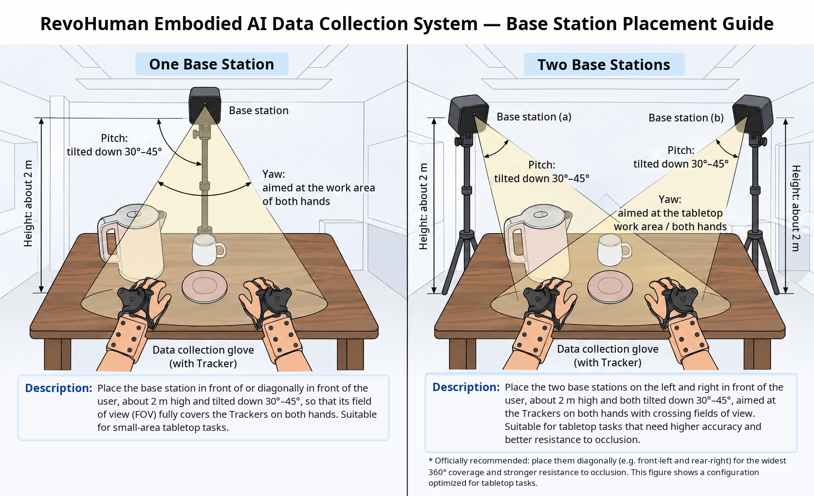
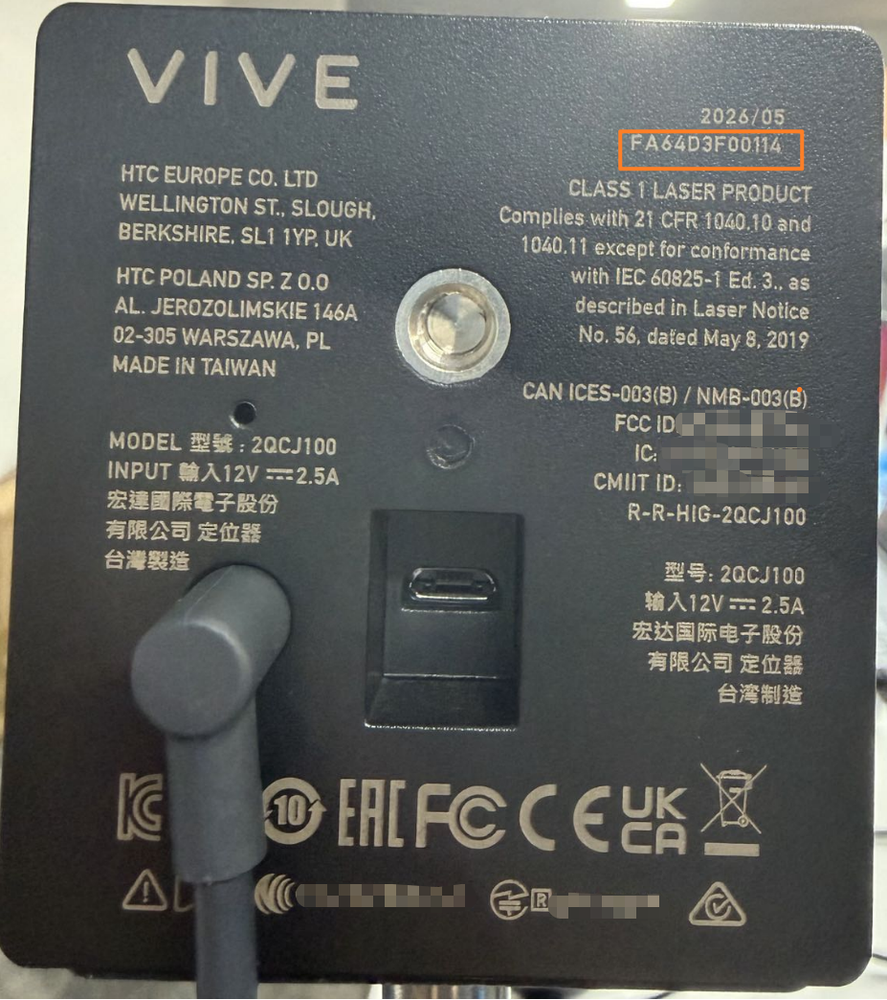

# RevoHuman SDK

English | [简体中文](README.zh-CN.md)

Capture SDK for the RevoHuman data glove: reads joint angles of both hands, Tracker poses, full-finger tactile data and wrist cameras,
assembles itself automatically by product model, provides two entry points (Python and ROS 2), and can record the whole data set to MCAP.

| Product model | Components |
|---|---|
| **P1** | Encoder glove (21 joints per hand) + Vive Trackers for both hands |
| **PTV1** | P1 + full-finger tactile (241 taxels) + wrist cameras |

This document covers only installation and getting started. For all interfaces, data semantics, ROS topics and parameters, and error codes, see [*RevoHuman SDK Reference Manual*](docs/reference-manual.md) (`docs/reference-manual.md`).
The detailed P1 user manual (installation, hardware connection, base stations, recording, simulation, ROS 2, logging and error codes, running in containers, timestamp synchronization) starts at [`docs/00-overview.md`](docs/00-overview.md).

---

## Supported hardware

| Part | Requirement |
|---|---|
| Glove | RevoHuman P1 or PTV1, one each for the left and right hands, connected to the host over USB |
| Tracker | Vive Tracker, one per hand, plugged into the USB HUB of that hand's glove unit |
| Base station | SteamVR Base Station 2.0, 1–4 units (the serial number on the back label starts with `FA` and has 12 characters) |
| Bluetooth | One working Bluetooth adapter on the host (used to read the base station serial numbers and channels) |
| Wrist camera | Built into PTV1, one per hand |

## System requirements

| Item | Requirement |
|---|---|
| Operating system | Ubuntu 22.04 |
| Python | CPython 3.10 (the `python3` that ships with Ubuntu 22.04) |
| Architecture | x86_64 / aarch64 |
| ROS 2 | Humble, needed only when using the ROS 2 nodes (step ⓪ of the step-by-step install) |

The core SDK is distributed as compiled modules: a wheel can only be installed on the Python version and architecture named in its file name; pip rejects a mismatched one.

---

## Installation

Download the release files from [GitHub Release v0.1.4](https://github.com/BrainCoTech/brainco-revohuman-sdk/releases/tag/v0.1.4). For the source bundle, download `revohuman-0.1.4-bundle.tar.gz`; do not use the Source code archives generated automatically on that page (their directory name differs; the commands in this document assume the `revohuman-0.1.4/` directory extracted from the source bundle).

Release files:

| File | Contents |
|---|---|
| `revohuman-<version>-cp310-cp310-linux_x86_64.whl` | Core SDK, x86_64 |
| `revohuman-<version>-cp310-cp310-linux_aarch64.whl` | Core SDK, aarch64 |
| `pysurvive-1.1.21+revohuman.3-cp310-cp310-linux_x86_64.whl` | Tracker driver libsurvive, x86_64 |
| `pysurvive-1.1.21+revohuman.3-cp310-cp310-linux_aarch64.whl` | Tracker driver libsurvive, aarch64 |
| `revohuman-<version>-bundle.tar.gz` | Source bundle: ROS 2 packages, hand models (URDF), examples, docs, simulation, Docker image build files, one-step install script |
| `SHA256SUMS` | Checksums |

The examples below assume the release files are placed in `~/revohuman-release`. Choose one install method according to your use:

| Install method | Suited for | What gets installed |
|---|---|---|
| [One-step install into a virtual environment](#one-step-install-into-a-virtual-environment-without-ros-2) | Using the Python API, command line, recording and 3D visualization, **without ROS 2** | All dependencies except ROS 2, installed into a separate virtual environment `revohuman_sdk` |
| [Step-by-step install](#step-by-step-install-with-ros-2) | Using the ROS 2 nodes | ROS 2 Humble, the SDK (installed in the user directory), the ROS 2 packages, 3D visualization |
| [Containers](#containers) | The host is not Ubuntu 22.04, or you do not want to install any dependencies on the host | Everything installed in a Docker image |

The first two can be installed on the same host. Configuration and calibration such as the base station allowlist, base station geometry and zero pose are stored in the home directory
(`~/.config/revohuman`, `~/.config/libsurvive`, `~/.local/state/revohuman`); both install methods share one copy, so switching to the other does not require pairing or calibrating again.

### One-step install into a virtual environment (without ROS 2)

Extract the source bundle and run `install_venv.sh` in its root directory as a regular user (do not prefix `sudo`; the script asks separately before steps that need `sudo`):

```bash
cd ~/revohuman-release
tar xzf revohuman-0.1.4-bundle.tar.gz              # → revohuman-0.1.4/
revohuman-0.1.4/install_venv.sh
```

As needed, the script installs system dependencies and the Tracker device rules and adds the current user to the `dialout` group (asking one by one before each step that needs `sudo`),
then creates a virtual environment in `~/.venvs/revohuman_sdk`, installs the bundled pysurvive, the SDK (with the four extras for recording, camera image decoding, base station Bluetooth
and 3D visualization) and the 3D visualization dependencies, and finally runs a self-check.
The virtual environment does not modify the system Python or the Python packages in the user directory; when run again, already installed parts are skipped automatically. On networks in China, add `--mirror cn`.
The script needs CPython 3.10, which is what Ubuntu 22.04 ships with. For a description of each step and all options, see
section 11 of [`docs/01-installation-and-requirements.md`](docs/01-installation-and-requirements.md), or run `install_venv.sh --help`.

Activate the virtual environment before use; after that, `python3 -m revohuman`, `revohuman-live` and `revohuman-lighthouses` can be used directly:

```bash
source ~/.venvs/revohuman_sdk/bin/activate
python3 -m revohuman --help
```

Activate it once in every new terminal; `deactivate` leaves the virtual environment. After being added to the `dialout` group for the first time, you must **log out and log back in once** before the glove serial ports can be opened.
Then continue with [Quick start](#quick-start); the virtual environment does not contain ROS 2, so to use the ROS 2 nodes, install again with the step-by-step install below.

### Step-by-step install (with ROS 2)

**⓪ ROS 2 Humble**

Add the ROS 2 package repository:

```bash
sudo apt update
sudo apt install -y software-properties-common curl gnupg lsb-release
sudo add-apt-repository -y universe
sudo curl -sSL https://raw.githubusercontent.com/ros/rosdistro/master/ros.key -o /usr/share/keyrings/ros-archive-keyring.gpg
echo "deb [arch=$(dpkg --print-architecture) signed-by=/usr/share/keyrings/ros-archive-keyring.gpg] http://packages.ros.org/ros2/ubuntu $(. /etc/os-release && echo $UBUNTU_CODENAME) main" | sudo tee /etc/apt/sources.list.d/ros2.list > /dev/null
```

> If `packages.ros.org` is slow from networks in China, replace `http://packages.ros.org/ros2/ubuntu` above
> with `https://mirrors.aliyun.com/ros2/ubuntu`, leaving everything else unchanged.

Install ROS 2 and the build tools, and have every new terminal load the ROS environment automatically:

```bash
sudo apt update
sudo apt install -y ros-humble-ros-base ros-dev-tools
echo "source /opt/ros/humble/setup.bash" >> ~/.bashrc
source /opt/ros/humble/setup.bash
```

**① System dependencies and serial port permissions**

```bash
sudo apt update
sudo apt install -y python3-pip python3-venv bluez libgl1 libegl1
sudo usermod -aG dialout $USER
```

`python3-venv`, `libgl1` and `libegl1` are used by the 3D visualization; all three are required.

**② Tracker driver libsurvive (the bundled pysurvive 1.1.21+revohuman.3)**

```bash
cd ~/revohuman-release
sha256sum -c SHA256SUMS
python3 -m pip install --user --no-deps pysurvive-1.1.21+revohuman.3-cp310-cp310-linux_$(uname -m).whl
sudo tee /etc/udev/rules.d/81-revohuman-tracker.rules > /dev/null <<'RULES'
# Vive Tracker（USB 有线，28de:2300）
SUBSYSTEM=="usb", ATTRS{idVendor}=="28de", ATTRS{idProduct}=="2300", MODE="0666"
KERNEL=="hidraw*", SUBSYSTEM=="hidraw", ATTRS{idVendor}=="28de", ATTRS{idProduct}=="2300", MODE="0666"
RULES
```

The bundled pysurvive is based on upstream 1.1.21 (libsurvive `v1.01-21-gd89876a`) and contains driver fixes this SDK requires.
Install this copy, not `pysurvive==1.1.21` from PyPI or any other version; on machines where one is already installed, running the commands above replaces it.

`--no-deps` must not be omitted: pysurvive declares a GUI dependency (wxPython) that the SDK does not use and that cannot be installed on Linux.

Apply the rules (Trackers already plugged in must be unplugged and plugged in again once):

```bash
sudo udevadm control --reload-rules && sudo udevadm trigger
```

**③ SDK, source bundle and 3D visualization environment**

```bash
cd ~/revohuman-release
WHL=revohuman-0.1.4-cp310-cp310-linux_$(uname -m).whl
python3 -m pip install --user "$WHL[recording,camera,ble,viewer]"
tar xzf revohuman-0.1.4-bundle.tar.gz              # → revohuman-0.1.4/
echo 'export PATH="$HOME/.local/bin:$PATH"' >> ~/.bashrc
export PATH="$HOME/.local/bin:$PATH"
revohuman-0.1.4/simulation/run_viewer.sh --help    # sets up the visualization's own Python environment; about 1–2 minutes the first time
```

The four extras are, in order: MCAP recording, camera image decoding, base station Bluetooth, and 3D visualization. The 3D visualization additionally uses its own Python environment
in `simulation/.venv`, independent of the SDK; seeing the option help means it is ready.

**④ Log out and log back in once** so that the `dialout` group, the ROS 2 environment and `~/.local/bin` (the directory containing the `revohuman-live` and `revohuman-lighthouses`
commands) take effect.

### Containers

If you **do not want to install ROS 2 and Python dependencies on the host**, you can use `install.sh` in the source bundle's `docker/` directory to build a Docker image in one step and run from it;
the host only needs Docker (if it is not installed, the script asks and then installs it for you). For building and running, see [`docker/README.md`](docker/README.md).

---

## Quick start

Run the commands below in the `~/revohuman-release/revohuman-0.1.4/` directory extracted from the source bundle, with the gloves and Trackers plugged in and the base stations powered on.
If you installed into the virtual environment, first run `source ~/.venvs/revohuman_sdk/bin/activate`.
Both Trackers must be powered on first: **briefly press** the power button on the Tracker until the indicator turns **green** (blinking blue means the button was held too long and the Tracker entered wireless pairing mode, which this kit does not use; hold the button for about 5 seconds to power off, then press briefly to power on; blinking red means low battery, and it can be used while charging over USB). The Tracker sends data directly over the glove unit's USB cable and does not need SteamVR wireless pairing; for details, see section 2.1 of [`docs/02-hardware-connection.md`](docs/02-hardware-connection.md).

### 1. Health check

```bash
cd ~/revohuman-release/revohuman-0.1.4
python3 -m revohuman doctor              # read-only: connected glove units and serial ports, handedness, USB topology, camera port positions on the same HUB
python3 -m revohuman doctor --probe      # also briefly opens the serial ports to read the handedness stored in firmware and firmware info (do not add while capturing)
```

Handedness is stored in the glove firmware; on the first health check, and after replugging or rebooting, `--probe` is needed to read it. Without it, newer gloves show `未认定手别` (handedness not identified).
The Tracker is not covered by the health check; for its self-check, see `tracker check --live` in step 3.

### 2. Confirm the product model and left/right hands

```bash
python3 -m revohuman product identify
```

The SDK identifies the left and right hands from the handedness stored in the glove firmware; for older gloves whose firmware has no handedness stored, it uses the handedness character in the USB serial number. The product model is identified from the serial number and the connected hardware.
If it cannot identify them, it refuses to start and states the reason instead of guessing from the port order; in that case, specify the serial ports explicitly (reference manual 2.1, 2.3).

### 3. Prepare the base stations (once per site)

**Placement**: mount the base stations at a height of about 2 m (above head height), tilted down 30°–45°, aimed at the working area of both hands.
Place a single base station in front of the person or diagonally in front; place two on the left and right sides in front, with crossing fields of view; when coverage from all around is needed, place them diagonally instead (for example front-left and rear-right).
Fix them firmly once placed: if they are moved or knocked askew after calibration, calibration must be redone.

**Environment**: keep the base stations and the working area out of direct sunlight and strong light, keep reflective surfaces such as mirrors, glass and shiny metal out of the base stations' field of view, and keep the space between the base stations and the Trackers unobstructed.
If calibration keeps stopping at `几何置信度偏低` (low geometry confidence), or the Tracker pose drifts while it is stationary, the cause is most likely environmental interference.
For the full list of precautions (based on VIVE's official guidance), see section 1.1 of [`docs/03-base-stations-and-pairing.md`](docs/03-base-stations-and-pairing.md), "Placement environment".



**Pairing and calibration**: the base station serial number is printed on the back label, starts with `FA` and has 12 characters (orange box in the image below); the allowlist accepts only this number.
First scan to confirm the SDK can read it, write it into the allowlist, scan again to confirm there are no channel conflicts, and finally calibrate the base station positions:



```bash
revohuman-lighthouses scan                  # scan nearby base stations: serial number / channel / signal
revohuman-lighthouses init                  # write the allowlist config file and print its path
${EDITOR:-nano} ~/.config/revohuman/lighthouses.yaml   # replace the placeholders with the serial numbers on your base stations' back labels
revohuman-lighthouses scan                  # passes only when every allowlisted unit shows ✓ and there is no same-channel conflict
python3 -m revohuman tracker calibrate      # calibrate the base station geometry
python3 -m revohuman tracker check --live   # start one capture to confirm that base stations and trackers are ready
```

`${EDITOR:-nano}` opens the editor named by the `EDITOR` environment variable, or nano if it is not set; if neither is available, open this file with any text editor on the machine (for example `gedit`, `vi`), or first run `sudo apt install nano`.

Allowlist file format:

```yaml
lighthouses:
  - FAXXXXXXXXXX          # serial number on the back label of the first base station
  - serial: FAYYYYYYYYYY  # the second one
    place: 右后上方        # location note (here "upper rear right"), used in errors to tell which unit it is
```

- If the second `scan` reports a same-channel conflict: run `revohuman-lighthouses plan` to see the channel change plan, `revohuman-lighthouses apply --yes` to apply it, then go back to `scan`.
- Before calibration and `check --live`, check that the indicators on both Trackers are green; if one is not lit, briefly press its power button to turn it on.
- During calibration, hold the Tracker in an area visible to all base stations and **move to a new position and orientation → hold still for about 1 second → move again**, until the command reports completion.
- The geometry is saved to disk and reused automatically at every later start. After base stations are moved, replaced, added or removed, or have their channels changed, run `scan` and `tracker calibrate` again.
- Once the allowlist is filled in, the subsequent scan, calibration and `check --live` can also be done with a single command, `./calibrate_lighthouses.sh` in the source bundle root (it only reads the base stations and stops on conflicts).
- For step-by-step instructions, see [`docs/03-base-stations-and-pairing.md`](docs/03-base-stations-and-pairing.md).

### 4. Capture

Before starting, put both hands in the zero pose: the SDK records the zero pose automatically from the pose at startup, and the Tracker `delta` values are all relative to it.

```python
from revohuman import open_kit

with open_kit() as kit:                        # identify the product model and assemble all sensors
    print(kit)                                 # RevoHumanKit(PTV1, hands=['left', 'right'], sensors=[...])

    sub = kit.synchronizer().subscribe()       # paired frames of both hands
    pair = sub.recv(timeout=1.0)
    print(pair.skew_ns, pair.left.joints_deg[:3])

    print(kit.tracker.delta("right"))          # pose of the right-hand tracker relative to the zero pose

    rec = kit.recorder()                       # already wired to all data streams of this kit
    handle = rec.start("episode_001.mcap")
    ...
    print(handle.stop())                       # {"frames": ..., "per_channel": {...}}
    rec.close()
```

Runnable version: `python3 examples/kit_quickstart.py`.

The mounting pose of the PTV1 wrist camera relative to the palm and the camera intrinsics are queried with `revohuman.calibration`: the per-unit value is used when a per-unit calibration exists, otherwise the model default; see reference manual 5.7.

### 5. Live view

One command starts the broadcast and the visualization window:

```bash
simulation/run_sim_host.sh       # starts revohuman-live in the background and opens a MuJoCo window in the foreground showing the joints of both hands and the Tracker poses
```

Closing the window also stops the broadcast the script started. Without hardware, use `simulation/run_sim_host.sh --demo P1` to view a demo;
when running in a container, run `simulation/run_sim_docker.sh` on the host instead.
For usage, options and common problems, see section 4 of [`docs/05-simulation-and-visualization.md`](docs/05-simulation-and-visualization.md).

---

## ROS 2

```bash
source /opt/ros/humble/setup.bash
mkdir -p ~/ros2_ws/src && ln -s ~/revohuman-release/revohuman-0.1.4/ros2/* ~/ros2_ws/src/
cd ~/ros2_ws && colcon build --symlink-install
```

```bash
source /opt/ros/humble/setup.bash && source ~/ros2_ws/install/setup.bash
ros2 launch revohuman_bringup revohuman.launch.py      # both hands, product model detected automatically
```

`--show-args` lists all launch arguments; for topics, services and parameters, see section 7 of the reference manual.
The ROS node and the Python entry point open the same gloves and Trackers; do not run both at the same time.

---

## Command line

`python3 -m revohuman [-v] <command>`; all commands except `live` support `--json`:

| Command | Description |
|---|---|
| `doctor [--probe]` | Health check |
| `product identify` | Identify the product model and left/right hands |
| `tracker calibrate` | Calibrate the base station geometry |
| `tracker check [--live]` | Startup self-check |
| `tracker status` | Offline view of the allowlist, geometry, zero pose and the result of the last startup check |
| `tracker set-reference` | Re-record the zero pose |
| `tracker preflight` | Quick version that only runs the channel preflight check (passive scan, does not connect to base stations) |
| `tracker lighthouses <subcommand>` | Same as `revohuman-lighthouses <subcommand>` |
| `live` | Live broadcast on this machine, same as `revohuman-live` |
| `firmware info` / `firmware upgrade` | Glove firmware version / upgrade (reference manual 2.4) |
| `glove calibrate` | Glove encoder zero-pose calibration, written to the glove, cannot be undone (reference manual 2.5) |

Base stations are managed with `revohuman-lighthouses <subcommand>`: `scan`, `show`, `init`, `plan`, `apply`, `set-channel`, `identify`.

Scripts in the source bundle (all support `--help`):

| Script | Description |
|---|---|
| `install_venv.sh` | One-step install into a virtual environment (without ROS 2) |
| `calibrate_lighthouses.sh` | One-step base station calibration: scan → calibrate → startup self-check (add `--docker` to run it in the container) |
| `simulation/run_sim_host.sh` | One-step start of the broadcast and 3D visualization on the host |
| `simulation/run_sim_docker.sh` | One-step start of the broadcast and 3D visualization in a container |
| `simulation/run_viewer.sh` | Start only the 3D visualization |
| `docker/install.sh` / `docker/run.sh` | One-step Docker image build / enter the container |

Exit codes: `0` success; `1` failure or not ready; `2` usage error; `3` refused or product model mismatch; `calibrate_lighthouses.sh` also has `4` (the allowlist is not filled in or the scan did not pass; deal with that first). For the full options, see section 8 of the reference manual.

## When errors occur

All SDK exceptions inherit from `revohuman.RevoHumanError`; `revohuman.format_error(exc)` gives readable text with the error code;
when the Tracker startup check fails, `TrackerNotReady` is raised, and the exception includes fix commands that can be copied and run directly. For the error code table, see reference manual 6.5.

## Known limitations

- **Jump on regaining line of sight**: at the moment the Tracker becomes visible again, the raw pose jumps once (measured about 2–3.5 cm, and up to about 30° in orientation).
  `rt.latest()` / `delta()` apply occlusion-recovery smoothing by default, spreading this jump into a gradual shift of about 0.3–1.6 seconds; recording files and ROS topics contain the raw pose,
  which keeps the jump. Runtime protection only counts, and warns about, jumps where the displacement between two adjacent frames exceeds 5 cm or the rotation exceeds 17.2°; smaller jumps are not counted.
- **Blind spot for moved base stations**: at runtime the SDK does not re-solve the base station positions, so it cannot detect a base station being translated or rotated about the vertical axis, with one base station or several;
  a tilt of 2° or more is detected and stops capture; a tilt under 2° is not detected.
  After moving a base station, always run `tracker calibrate` again.
- **Capture stops caused by gravity-reading jitter**: the driver judges whether a base station has been moved from the gravity direction the base station broadcasts; when this changes by 2° or more, it clears that base station's position
  and rewrites the base station configuration, and the SDK then stops capture, reporting that the base station geometry is invalid or that the base station has been moved. This also happens when nobody touched the base station but the reading occasionally jitters by more than 2°.
  Restarting does not help in this case; as prompted, run `revohuman-lighthouses scan`, then run `python3 -m revohuman tracker calibrate` to recalibrate.

## Usage notes

- A glove, or a libsurvive instance, can be opened by only one process at a time; a second process gets `PortBusyError` / `TrackerBusyError` (with the holder's pid).
- When data from multiple hosts must be aligned, have them all synchronize time to the same NTP server (reference manual section 10).
- The glove serial number is written at the factory; the SDK only reads it and never writes it.
