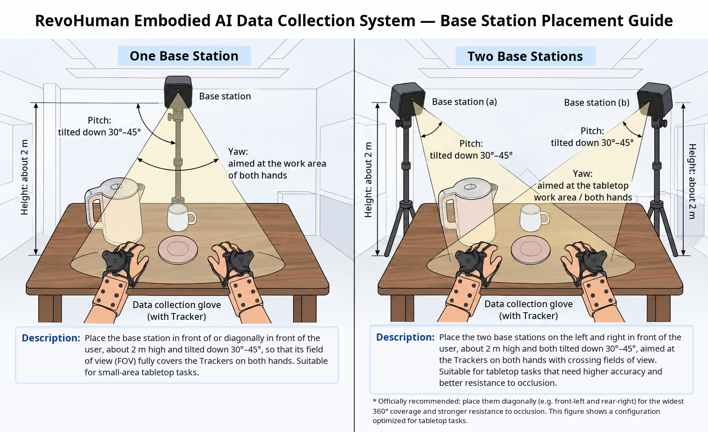
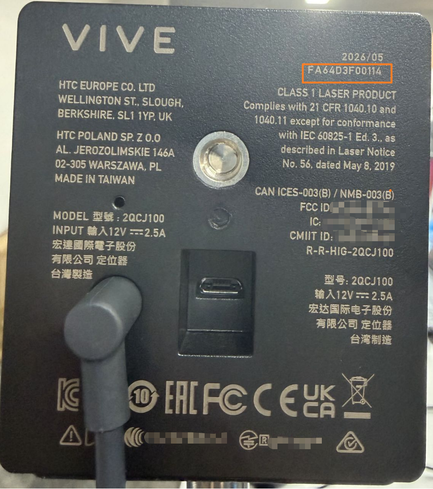

# 03 Base Stations and Pairing

English | [简体中文](zh-CN/03-基站使用与配对.md)

The Tracker's position and orientation are computed from the infrared light swept out by the base stations. The SDK first needs to know "which base stations are in use",
and then "where these base stations are", before it can give a trustworthy pose. This chapter does both:

1. **Pairing**: add the base stations in use to the allowlist, and confirm that their channels do not conflict with each other;
2. **Calibration**: a person wearing the gloves walks around in front of the base stations so that the SDK can solve for the base station positions (hereafter "base station geometry").
   Calibration also determines the coordinate frame in which Tracker poses are expressed; see section 5.3 for the definition.

When this is needed:

| Situation | What to do |
|---|---|
| First use | This whole chapter (sections 2–6) |
| Changed site; moved or knocked a base station out of position; added or removed base stations | Section 4 (when the allowlist changes) + recalibrate per section 5 |
| A program reports that the base station geometry is invalid or has been moved, or asks for recalibration | Recalibrate per section 5 (read section 7 first) |
| Daily use after power-on | Only the startup self-check in section 6 |

## 1. Before you start

- All steps in *01 Installation and System Requirements* have been completed (this chapter uses the Bluetooth package `bluez` and the SDK's base station Bluetooth component from it).
  When using a Docker container, see section 7 of *08 Running in Containers* for how each step in this chapter is run on the host and in the container.
- Both gloves are connected per *02 Hardware Connection*, and `python3 -m revohuman doctor` shows `fail=0`.
  During calibration the SDK finds each hand's Tracker automatically through the glove unit; if a glove is not connected, its Tracker cannot be found.
- Both Trackers are powered on and their lights are green. For how to power them on and what each light color means, see section 1.2.
- The base stations are powered and **firmly mounted**: on a stand or a wall, above head height, facing down toward the work area; do not put them on a desk where people may bump them.
  Once a base station is moved or knocked out of position after calibration, you must recalibrate. For placement see section 1.1.
- The lighting and surroundings of the work area have been checked per "Placement environment" in section 1.1: no direct sunlight or strong light, and no reflective surfaces such as mirrors or glass in the base stations' field of view.
- Close all programs that are using the Trackers: `revohuman-live`, the live mode of the visualization, recording scripts, ROS 2 nodes.
  A set of Trackers can be opened by only one program at a time, and the commands in sections 5 and 6 need exclusive access to it.

### 1.1 Base station placement recommendations



- **Height and orientation**: mount the base stations at about 2 m (above head height), tilted down by 30°–45°, aimed horizontally at the work area of both hands.
- **One base station**: place it in front of the person or diagonally in front; its field of view must fully cover the Trackers on both hands. Suitable for small-range work on a desk.
- **Two base stations**: place them on the left and right sides in front of the person, with their fields of view crossing over the work area; this is more accurate and less prone to occlusion.
  When the person needs to turn around and coverage is required all around, place them diagonally instead (e.g. front left and rear right).
- Once placed, fix them firmly, then add them to the allowlist per section 4. In the allowlist you can use `place` to note where each one is (section 4.3), which makes it easier to tell which one an error refers to.

**Placement environment**

The Tracker locates itself by receiving the infrared light swept out by the base stations; strong light, reflections and occlusion in the environment directly interfere with tracking.
When calibration keeps stalling at `几何置信度偏低` (low geometry confidence), or the pose drifts while the Tracker is stationary, the most common cause is the environment.
The following items follow VIVE's official guidance on using SteamVR base stations and Vive Trackers:

- **Avoid strong light**: neither the base stations nor the work area should be in direct sunlight, and do not let strong lamps shine directly on the base stations or Trackers.
  In rooms with many windows and strong sunlight, draw the curtains during calibration and data collection.
- **Remove reflective surfaces**: in the base stations' field of view and around the work area there should be no reflective surfaces such as mirrors, glass (windows, glass doors, glass tabletops), glossy paint, polished metal parts,
  glossy desk surfaces or displays; cover the ones that cannot be moved with cloth or matte material. Reflections make the Tracker receive light bounced off other places and solve a wrong position.
  How to check: stand where the base station is and look toward the work area; every glossy surface within your line of sight needs to be dealt with.
- **Clear line of sight**: there must be no objects between the base stations and the Trackers; during data collection every Tracker must be lit by at least one base station.
  Do not put other equipment, partitions or similar obstructions directly in front of a base station.
- **Stable, vibration-free mounting**: use a tripod or light stand, or fix them to a wall or a stable surface; do not mount them on stands or surfaces that wobble or vibrate,
  or where people walking back and forth may easily bump them. Once the base stations are powered on, do not move them or adjust their angle.
- **Face the work area**: the front of each base station faces the center of the hands' work area. The field of view of SteamVR Base Station 2.0 is about 150° horizontal and 110° vertical;
  the range of hand movement must fall within the field of view.
- **Keep a distance from the Tracker**: the Tracker should be at least 0.5 m from a base station.
- **Keep away from infrared devices**: the infrared signals emitted by the base stations may interfere with nearby infrared remote controls, infrared sensors and similar devices; keep the two apart as far as possible.

After changing the environment (covering reflective surfaces, changing curtains, moving base stations, etc.), recalibrate per section 5.

Official sources:
[Tips for setting up SteamVR Base Station 2.0](https://www.vive.com/us/support/vive-pro2/category_howto/tips-for-setting-up-base-station2.html),
[Installing the base stations](https://www.vive.com/us/support/vive-pro2/category_howto/installing-the-base-stations.html),
[SteamVR Base Station 2.0](https://www.vive.com/us/support/camtrack/category_howto/base-station2.html),
[What to do when seeing drifting objects](https://www.vive.com/us/support/vive-pro-eye/category_howto/what-to-do-when-seeing-drifting-objects.html),
[Setting up your play area for tracking](https://business.vive.com/us/support/vive-lbss/category_howto/setting-up-your-play-area-for-tracking.html).

### 1.2 Power on the Tracker and check the light

The Tracker must be powered on to receive light from the base stations. Before pairing and calibration, do the following for each of the two Trackers:

1. Find the power button on the Tracker (the only button on the Tracker, not the button on the glove).
2. **Press briefly once** to power on. Do not hold it: holding for about 2 seconds enters wireless pairing mode, which this kit does not use.
3. Look at the status light; **once it turns green**, the Tracker is powered on and working normally, and you can continue.

| Light | Meaning | What to do |
|---|---|---|
| Green | Normal mode | Continue with section 2 |
| Blue (solid or blinking) | Solid: connecting; blinking: entered wireless pairing mode | If solid, wait a few seconds to see whether it turns green; if blinking, or it never turns green, hold the power button for about 5 seconds to power off, then press briefly to power on |
| Blinking red | Low battery | Keep the USB cable connected to charge it; it can be used while charging |
| Off | Powered off | Press the power button briefly to power on |

The Trackers in this kit pass data directly to the host over the glove unit's USB cable and **do not need wireless pairing in SteamVR**;
"pairing" in this chapter means adding base stations (section 4) and has nothing to do with wireless pairing of the Tracker.
According to the official documentation, the Tracker powers off automatically after more than 5 minutes without movement (the light goes out); press briefly to power it on again.
For the full description of the power button and status light, see section 2.1 of *02 Hardware Connection*.

A green light only means that the Tracker powered on normally. Whether it can see the base stations: go by the results of the calibration in section 5 and of `tracker check --live` in section 6.

## 2. Bluetooth

The serial numbers and channels of the base stations can only be read over Bluetooth, so **pairing and the pre-calibration checks both depend on Bluetooth**.
Normally the SDK only reads information from the base stations; only the blink in section 4.2 and the channel change in section 4.5 write to the base stations.

Check that the Bluetooth service is running and the adapter is powered on:

```bash
systemctl is-active bluetooth
bluetoothctl show | grep Powered
```

You should see `active` and `Powered: yes`. If not, run the following three commands in order, then check again:

```bash
sudo systemctl enable --now bluetooth
sudo rfkill unblock bluetooth
bluetoothctl power on
```

If `bluetoothctl show` reports `No default controller available`, the machine has no usable Bluetooth adapter; plug in a USB Bluetooth adapter.

## 3. Where the configuration file is

The base station allowlist and the calibration thresholds are written in one configuration file. Its default location is:

```text
~/.config/revohuman/lighthouses.yaml
```

To keep it elsewhere, set the path with the environment variable `REVOHUMAN_LIGHTHOUSES`, or add `--whitelist <路径>` (the path) to each command
(the command line takes precedence over the environment variable, and the environment variable over the default location).

Each command in this chapter starts by printing a line `配置：<路径>（…）` (config: path (…)), showing which file was read this time.
When an allowlist file also exists in another location but was not read this time, an extra line `配置：! …` names that file.

## 4. Pairing the base stations

### 4.1 Scanning for nearby base stations

```bash
revohuman-lighthouses scan
```

The scan takes about 10 seconds, during which it connects to each base station in turn to read its serial number. When finished, it lists all nearby base stations:

```text
扫到 1 台基站（10s）；✓ = 在白名单
  序列号             广播名             信道     信号  白名单
  FAXXXXXXXXXX      LHB-XXXXXXXX     4    -58  ✓
✓ 白名单 1 台都扫到，信道无冲突；信道预检已刷新（5 分钟内有效）
```

| Column | Meaning |
|---|---|
| `序列号` (serial number) | The 12-character number starting with `FA` on the label on the back of the base station (see the image below); **the allowlist only accepts this** |
| `广播名` (advertised name) | The name starting with `LHB-` shown in Bluetooth; for identification only |
| `信道` (channel) | The base station's operating channel. Every base station at the same site must have a different channel |
| `信号` (signal) | Bluetooth signal strength (dBm); the closer to 0, the nearer the station |
| `白名单` (allowlist) | `✓` means it is in the allowlist |



The serial number is printed on the label on the back of the base station (the orange box in the image above). Identifying base stations in section 4.2 and writing the allowlist in section 4.3 both use this number;
the serial numbers in the `scan` list should match the ones on the labels.

On the first scan there is no allowlist yet, so the last line reports that the allowlist does not exist or that nothing is listed in it. This is normal; continue with 4.2.
If the serial number column of a base station shows `?（…）`, its serial number was not read this time; move closer to it and scan again.

### 4.2 Telling which station is which (with many base stations)

When there are many base stations at the site and you cannot tell which physical station a serial number in the list belongs to, you can make one of them blink and identify it on site:

```bash
revohuman-lighthouses identify FAXXXXXXXXXX --seconds 10 --foreign
```

Replace `FAXXXXXXXXXX` with a serial number from the list (the advertised name `LHB-XXXXXXXX` also works).
If the base station to blink is not in the allowlist, `--foreign` is required; otherwise the command reports that it is a foreign station and does not make it blink. Before the allowlist is written (4.3), all base stations count as foreign stations.
Base stations that are already in the allowlist do not need it.

### 4.3 Writing the allowlist

First generate a configuration file template (if the file already exists, it is not overwritten and the message `已存在，没有覆盖` (already exists, not overwritten) is shown; just edit the existing file):

```bash
revohuman-lighthouses init
```

Open it and fill in the **serial numbers** of the base stations to use under the `lighthouses` section, one line per station:

```bash
${EDITOR:-nano} ~/.config/revohuman/lighthouses.yaml
```

`${EDITOR:-nano}` opens the editor specified by the environment variable `EDITOR`, or nano if it is not set; if neither is available, open the file with any text editor on this machine (e.g. `gedit`, `vi`), or run `sudo apt install nano` first.

What it looks like when filled in (two base stations; `place` is optional, but helps identify them later):

```yaml
lighthouses:
  - serial: FAXXXXXXXXXX
    place: 左前上方
  - serial: FAYYYYYYYYYY
    place: 右后上方
calibration:
  coverage_cells: 2         # view-coverage cells (at most 10 per base station; 2 or fewer is satisfied once poses are captured; 0 disables the whole view-coverage check)
  coverage_span_deg: 5      # angle (degrees) spanned left to right by the hands, as seen from the base station
```

- Fill in only the base stations **in use**. Do not fill in other people's base stations at the site; the SDK treats them as foreign base stations and excludes them.
- Do not fill in the advertised name or the channel; the SDK reads them over Bluetooth itself.
- Keep the `calibration` section at its defaults; it determines how many positions you need to go through during calibration in section 5.
- Do not commit a file that contains real serial numbers to a public code repository.

Check that the allowlist can be read correctly (no Bluetooth, returns immediately):

```bash
revohuman-lighthouses show
```

No `✗` means it is correct. If something is wrong, it reports which line and what is wrong, for example
`✗ <路径> 第 11 行：'FAXXXXXXXXXX' 是模板里的占位符：请换成基站背面标签上 FA 开头的 12 位序列号` (line 11: 'FAXXXXXXXXXX' is a placeholder from the template; replace it with the 12-character serial number starting with FA on the label on the back of the base station).

### 4.4 Scanning again to confirm the channels

```bash
revohuman-lighthouses scan
```

When the last line is `✓ 白名单 N 台都扫到，信道无冲突；信道预检已刷新（5 分钟内有效）` (all N allowlisted stations found, no channel conflict; channel preflight check refreshed, valid for 5 minutes), go straight to section 5.
Other cases:

| Message | Action |
|---|---|
| `✗ 白名单里的 … 本次没扫到` (… in the allowlist was not found in this scan) | The base station is not powered, too far away, or its serial number has never been read. Move closer, confirm that it is powered, and scan again |
| `✗ … 与 … 同在 chN` (… and … are both on chN) | Two allowlisted base stations have the same channel, and the Tracker cannot tell them apart. Change the channel per 4.5 |
| `! … 的信道从 chA 变成了 chB` (the channel of … changed from chA to chB) | The base station's channel has been changed. After confirming there is no conflict, you must recalibrate (section 5) |
| `蓝牙是必需的：…` (Bluetooth is required: …) | Bluetooth is unavailable; go back to section 2 |

### 4.5 Changing channels (only when there is a conflict)

First look at the automatic plan; this step only prints and does not write anything:

```bash
revohuman-lighthouses plan
```

When there is no conflict, the last line is `白名单里的站都不用挪` (none of the allowlisted stations needs to move), and the `apply` below does not need to be run.
When there is a conflict, the plan only moves base stations that are in the allowlist. After confirming it, run (this writes the new channels to the base stations and automatically rescans to verify):

```bash
revohuman-lighthouses apply --yes
```

Seeing `✓ 重扫复验通过` (rescan verification passed) and `下一步：revohuman-lighthouses scan（刷新信道预检）→ …` (next step: revohuman-lighthouses scan (refresh the channel preflight check) → …) means it is done.
**After changing channels you must calibrate per section 5**; the old calibration result is no longer valid.

## 5. Calibrating the base station geometry

### 5.1 Running the calibration

Calibration requires a successful scan within the last 5 minutes (the last line in section 4.4). Before starting, confirm that both Trackers' lights are green (section 1.2),
then scan first and start the calibration right after:

```bash
revohuman-lighthouses scan
```

```bash
python3 -m revohuman tracker calibrate
```

You can also use the one-step calibration script in section 5.4, which does the scan, the calibration and the startup self-check of section 6 in one command.

### 5.2 How to walk

Put on both gloves (Trackers on the backs of the hands), stand in the work area lit by the base stations, and face the base stations:

1. First **spread your hands apart to the left and right**, shoulder-width or wider, with the backs of the hands facing the base stations, and hold still for about 1 second;
2. **Move to another position** and hold still for about 1 second: step forward or back, raise or lower your hands;
3. Repeat step 2 as prompted on screen, pausing at each new position; do not keep moving all the time.

Throughout:

- Do not block the other hand's Tracker with your body or limbs, and do not turn your back to the base stations;
- Before starting, check per "Placement environment" in section 1.1: no direct sunlight or strong light, and no reflective surfaces such as mirrors, glass or glossy metal in the base stations' field of view; reflections cause wrong solutions;
- With multiple base stations, try to stand in the middle of the area lit by all of them.

During calibration a progress line is printed every second; what follows `→` is what to do next:

| Message | What to do |
|---|---|
| `请在基站视野内缓慢移动双手，每处停住约 1 秒` (slowly move both hands within the base stations' view, holding still for about 1 second at each spot) | No valid data seen yet: make sure you are standing in front of the base stations with the backs of your hands facing them |
| `基站看到的张角只有 …°（要 …°）：请把手左右挪开（从基站看过去横向移动，一只手来回挪也行），每处停住约 1 秒` (the angle seen by the base station is only …° (… ° needed): move your hands apart to the left and right (sideways as seen from the base station; moving one hand back and forth also works), holding still for about 1 second at each spot) | Seen from the base station, the left-right span of the hands is not yet wide enough: spread them farther apart. Moving up and down does not count |
| `视角格子 …/…：请把双手换到另一个位置（前后、高低各挪一次），每处停住约 1 秒` (view cells …/…: move both hands to another position (once forward/back, once higher/lower), holding still for about 1 second at each spot) | Change your standing position or height |
| `判据已满足，连续成立 3 秒即完成（已 …s）` (criteria met; completes once they hold for 3 seconds in a row (… s so far)) | That is enough; keep the Trackers within the base stations' view, and it completes automatically in a few seconds |
| `视角覆盖已达标` (view coverage reached), with `未达标：LHB-XXXXXXXX(几何置信度偏低)` (not passed: LHB-XXXXXXXX (low geometry confidence)) earlier on the same line | Enough walking has been done, but the result solved for this base station is too inconsistent to pass acceptance, most likely because of environmental interference (reflections, strong light). If it stays on this line for more than about 30 seconds, walking further usually does not help: press `Ctrl-C` to abort (it rolls back), troubleshoot per "Placement environment" in section 1.1, and rerun 5.1 |

With only one base station, it took about 10–20 seconds in measured runs from the first progress line to completion. The last line is:

```text
标定完成：在册基站均已解出：LHB-XXXXXXXX
```

The exit code is `0`. Other results:

| Result | Meaning and action |
|---|---|
| `标定失败：…` (calibration failed: …), followed by the line `（config 已回滚到标定前）` (config rolled back to before calibration), exit code `1` | This run did not produce a solution, or the solved result failed acceptance; the base station geometry has been restored to its state before calibration. Adjust according to the failure reason (e.g. change position, or deal with reflections and strong light per "Placement environment" in section 1.1), then rerun 5.1 |
| `标定失败：标定中有不在册的基站被一起解了出来：…` (calibration failed: a base station not in the allowlist was solved during calibration: …), followed by the line `（config 已回滚到标定前）`, exit code `1` | A base station outside the allowlist was also solved, and the geometry solved this time has been skewed by it, so it was discarded and rolled back without waiting for the timeout. Turn that base station off or move it out of view, then rerun 5.1; if it is one of your own base stations, first add it to the allowlist per section 4.3 |
| `标定被拒（…）：` (calibration refused (…):), exit code `3` | The preconditions for calibration were not met, and calibration did not start. For example, if more than 5 minutes have passed since the last scan, just rerun 5.1; for other reasons follow the message |
| Not finished after more than 5 minutes | Treated as a failure; it is rolled back as well |
| `Ctrl-C` abort | Prints `已中断` (interrupted), exit code `1`; it is rolled back as well, so you can safely start over. Ending the process with `kill` or closing the terminal also rolls back |

### 5.3 The coordinate frame from calibration

While solving for the base station positions, calibration also establishes a 3D Cartesian coordinate frame fixed to the site, hereafter the "base station frame".
All absolute Tracker poses are expressed in this frame: the SDK's `latest()`, the Tracker data in recording files, and the ROS 2 `tracker_pose` topic.

| Item | Definition |
|---|---|
| Type | Right-handed Cartesian coordinate frame |
| Units | Position in meters. Orientation as a unit quaternion: ordered (w, x, y, z) in the SDK and in recording files, and (x, y, z, w) in ROS 2 messages following ROS convention |
| +Z axis | Vertically up. Constrained during solving by the accelerometers built into the base stations and Trackers; close to, but not exactly, the plumb direction |
| +Y axis | Horizontal, pointing from the origin toward the **reference base station**: the reference base station is always directly above the +Y axis (its x is about 0 and its y is positive) |
| +X axis | Given by the right-hand rule (X = Y × Z): standing at the origin and facing the reference base station, +X points to your right |
| Horizontal origin | A position where a Tracker was held still during calibration, chosen automatically by the solver. It is not the position of a base station, nor any mark on the floor |
| Height zero | About the lowest height at which a Tracker was held still during calibration. z is the height relative to this, **not the height above the floor** |
| What the pose describes | The Tracker's own coordinate frame (defined by the Tracker's factory calibration data), not including the Tracker's mounting offset on the glove. When you need the palm pose, use `hand_fk.palm_from_tracker()` to convert using the product model's nominal mounting relation (*RevoHuman SDK Reference Manual* 6.7); it is not calibrated per unit, so if you need higher accuracy, measure the mounting relation yourself |

**Reference base station**: with only one base station, it is that one. With several, the calibration output prints
`Using LH … (xxxxxxxx) as reference lighthouse`; the last such line is the one that counts, and the value in parentheses is the 8-character ID of the reference base station
(the same as the ID in parentheses after the serial number in `tracker status`).

**The frame is determined by calibration**:

- Each calibration re-establishes the base station frame. The horizontal origin, the direction of +Y and the height zero depend on where the person stood and where the hands were during that calibration;
  **even if the base stations have not moved and you only recalibrate, the frame changes** (measured differences of nearly 20 cm and about 5°). Absolute poses from different calibrations cannot be compared directly.
- After calibration, the SDK does not re-solve the base station positions at runtime, and the frame stays the same; absolute poses under the same calibration can be compared directly.
- When a base station is moved, the frame becomes invalid. When the SDK detects this it stops data collection (section 7); for cases it cannot detect, see section 8. After moving a base station you must recalibrate.

**Increments relative to the zero pose**: the SDK's `delta()` and the ROS 2 `tracker_delta` topic give increments relative to the zero pose:
position = R₀ᵀ(p − p₀), orientation = R₀ᵀR, where p₀ and R₀ are the Tracker's position and orientation at the moment the zero pose was recorded.
The increments are expressed in **the Tracker's own frame at the moment of the zero pose**, independent of the origin and orientation of the base station frame.
By default the zero pose is recorded automatically each time data collection starts; see section 1 of *04 Recording*.

### 5.4 One-step calibration script

`calibrate_lighthouses.sh` in the root directory of the source bundle chains the scan in section 4.4, the calibration in sections 5.1–5.2 and the startup self-check in section 6 into one command.
Run it as a regular user:

```bash
cd ~/revohuman-release/revohuman-0.1.4
./calibrate_lighthouses.sh
```

The script runs five steps in order:

1. Check the allowlist. If there is no allowlist yet, it first scans for nearby base stations, then writes out an allowlist configuration file from the example (same as `revohuman-lighthouses init`),
   asks you to fill it in per section 4.3 and rerun, and exits with code `4`.
2. Identify the Trackers to use (skipped when `--tracker` is given): it identifies each glove by its MCU serial number, takes the Tracker plugged into the same USB HUB and prints it,
   reading only USB information without opening the devices. If none can be identified, it stops with exit code `2`; handle the `✗` lines and rerun. If only one is identified, only that one is used for calibration.
   When a glove's serial number does not reveal its handedness, or a Tracker is connected through a wireless receiver, it does not guess: add `--tracker left=LHR-... --tracker right=LHR-...` as prompted to specify them directly.
3. Scan the base stations and refresh the channel preflight check (same as section 4.4). If a base station in the allowlist is not found, or there is a same-channel conflict, it stops with exit code `4`;
   handle the `✗` lines at the end of the scan result and rerun. The script only reads information from the base stations and does not write to them; to change channels, do it manually per section 4.5.
4. Print how to walk (same as section 5.2), and start calibration after you press Enter. The progress messages and results mean the same as in section 5.2;
   if the wait for Enter exceeds 4 minutes, it rescans once before starting calibration, so that the channel preflight check does not expire.
5. After calibration completes, run `tracker check --live` once (section 6), then print `tracker status`.

Seeing `[calibrate_lighthouses] 完成。零位不用另外记：…` (done. The zero pose does not need to be recorded separately: …) with exit code `0` means everything is complete.
If you press `Ctrl-C` midway, the script stops the calibration and waits for it to roll back to the state before calibration before exiting.

The script looks for the SDK in this order: the virtual environment given by `--venv` → the environment variable `REVOHUMAN_VENV` or `~/.venvs/revohuman_sdk`
(the location installed by `install_venv.sh` in section 11 of *01 Installation and System Requirements*) → the `python3` of the current terminal
(it must be able to import `revohuman` and the Tracker driver `pysurvive`; when run inside the source directory, the source code in that directory does not count as an installed SDK).
If the SDK is installed system-wide per sections 3–10 of *01 Installation and System Requirements*, no option is needed. Common options:

| Option | Description |
|---|---|
| `--hands left` / `--hands right` | Use only one hand's Tracker (default: both) |
| `--tracker left=LHR-XXXXXXXX` | Specify a Tracker serial number directly; can be repeated; by default the Trackers are found automatically through the gloves |
| `-y` | Do not wait for Enter; start calibration right after the scan |
| `--no-check` | Skip the startup self-check after calibration |
| `--timeout 秒` | Maximum calibration time, in seconds (default 300) |
| `--scan-seconds 秒` | Duration of the base station scan, in seconds (default 10) |
| `--venv 目录` | Virtual environment (directory) that contains the SDK; `--venv none` uses the `python3` of the current terminal directly |
| `-- 参数…` | Arguments after `--` are passed unchanged to `python3 -m revohuman tracker calibrate`, e.g. `-- --coverage-cells 4` |

For all options see `./calibrate_lighthouses.sh --help`. Exit codes:

| Exit code | Meaning |
|---|---|
| `0` | Done: calibration and the startup self-check both passed |
| `1` | Calibration failed, and the base station geometry has been rolled back to before calibration (handle per the table at the end of section 5.2); or calibration completed but the startup self-check did not pass (handle per section 6) |
| `2` | Usage error; gloves, Trackers or the SDK not found; or Bluetooth unavailable (section 2). Calibration did not start |
| `3` | Calibration refused (see the table at the end of section 5.2). Calibration did not start |
| `4` | The allowlist is not filled in yet, or the scan did not pass (a base station was not found, or there is a same-channel conflict). Calibration did not start |
| `130` / `143` / `129` | Interrupted by `Ctrl-C`, `kill`, or closing the terminal. An unfinished calibration has been rolled back to before calibration; if the interruption falls right when calibration has just completed, the script states that the geometry has been updated and the startup self-check was not run |

When using a Docker container, run `./calibrate_lighthouses.sh --docker` on the host; see section 7.3 of *08 Running in Containers*.

## 6. Startup self-check

After calibration, and in daily use before each recording, confirm that the base stations are usable with the commands below.
Before starting, glance at the lights of both Trackers: if one is not green, handle it per section 1.2 first.

Check the files only, without opening devices; returns immediately:

```bash
python3 -m revohuman tracker check
```

Then open the Trackers once and actually verify the base stations and poses (takes a dozen or so seconds, at most about half a minute):

```bash
python3 -m revohuman tracker check --live
```

On pass you see `✓ S0 静态门 通过` (S0 static gate passed) and `✓ S1 起流后门（…） 通过` (S1 post-stream-start gate (…) passed), with exit code `0`; then each line lists a base station seen by a Tracker: allowlisted or foreign, 8-character ID and channel.
The `[tracker-gate] …` line is a summary for technical support troubleshooting and can be ignored.
With `--live`, some `Info:` / `Warning:` lines from the Tracker driver are printed first
(e.g. `Warning: Disabling LH 1` when there is only one base station). This is normal output; go by the final `✓` / `✗` lines.

On failure it shows `✗ … 被拦（原因代号）：` (… blocked (reason code):), followed by an explanation of the reason and a `修复：` (fix:) section with commands you can run directly, with exit code `1`.

If Tracker data collection did not start and the check has not reached the S1 decision, it shows `自查本身出错（起采集源失败）：…` (the self-check itself failed (could not start the capture source): …), with exit code `2`.
The reason follows the colon, e.g. `启动活性门未通过：init 后 25.0s 内 位姿 0 帧` (startup liveness gate failed: 0 pose frames within 25.0s after init), meaning that the Tracker receives light but cannot solve a pose. Check in the order listed in the message (an allowlisted base station that is not powered or is blocked is the most common cause), then rerun.

Check the current status at any time (offline, opens no devices):

```bash
python3 -m revohuman tracker status
```

```text
在册基站：FAXXXXXXXXXX（XXXXXXXX，左前上方）
信道预检：有效
基站几何：可用（已解出 1 台）
零位：无
上次启动门：S1 通过  MM-DD hh:mm:ss  mode=error
```

The last line is the result and time of the most recent startup check.

When the `基站几何` (base station geometry) line shows `不可用` (unavailable), the exit code is `1`; recalibrate per section 5.
It is normal for `信道预检` (channel preflight check) to show as expired; it is only needed before calibration (section 5.1 scans first).
`零位` (zero pose) is the pose of both hands' Trackers recorded when recording or another program starts (recorded in the frame of section 5.3), and by default it is recorded again at each start; the note in parentheses says whether this record can be reused. It cannot be reused after the base stations have been recalibrated or after it expires. See section 1 of *04 Recording*.

## 7. Runtime protection

During data collection only base stations that are in the allowlist and have been calibrated per section 5 are accepted: other people's nearby base stations, or base stations whose channel has changed, are not merged into the current frame.

During recording or broadcasting, the SDK checks the base station geometry once per second. When there is a problem, it discards the current segment of data or stops data collection,
and prints a line with an error code in the terminal. Meanings and actions:

| Message | Meaning | Action |
|---|---|---|
| `[1906] 运行期基站几何丢失（wipe）…` or `（changed）…` (runtime base station geometry lost) | The position of a base station no longer matches the calibration record: it was moved or knocked out of position, or the driver cleared its position (see item 3 in section 8). Poses from then on are no longer trustworthy; **data collection has stopped** | Exit the program, run `revohuman-lighthouses scan`, then run `python3 -m revohuman tracker calibrate` to recalibrate, then start again. **Restarting without recalibrating does not help**; the startup check will block it again |
| `[1906] 运行期基站几何丢失（unavailable）…`, ending with `当段已作废；去掉遮挡后几何门会自己放行` (segment discarded; the geometry gate lets data through again by itself once the occlusion is removed) | A base station is occluded and not enough base stations are usable, for about 3 seconds | The current segment of data is discarded; it recovers automatically once the occlusion is removed, no restart needed |
| `[1906] 运行期基站几何丢失（drift）…` | With multiple base stations, the distances between the base stations do not match the calibration record | Same as above: recovers automatically once the condition clears; if it keeps recurring, a base station is loose: fix it in place and recalibrate |
| Error code `1902`, message `世界系已变更` (world frame changed) | The position of an allowlisted base station changed during data collection; poses from then on are not in the same frame as before | Fix the base stations firmly, recalibrate per section 5, and start again |
| Error code `1902`, message `外来基站（不在册）被解进了世界系` (a foreign (non-allowlisted) base station was solved into the world frame) | A base station outside the allowlist was merged into the current frame; poses from then on are not in the same frame as before | Turn that base station off or move it out of view, then start again; if it is one of your own base stations, first add it to the allowlist per section 4.3, then recalibrate per section 5 |
| `运行中整体停流——tracker 全部掉线或 USB 被拔` (all streaming stopped while running — all trackers offline or USB unplugged) | No data from any Tracker for more than 10 seconds | Check the connections of the gloves and Trackers, and restart the program |
| Pose jump warning (displacement between two consecutive frames over 5 cm, or rotation over 17.2°) | Mostly occurs right after an occlusion ends | Warning only; data collection does not stop. If it occurs frequently, check occlusion, reflections and strong light per "Placement environment" in section 1.1 |
| At startup, `[1905] tracker 未就绪（…）：…` (tracker not ready) | The startup check did not pass | The error lists the reason and the fix commands; follow them |

For how to identify discarded segments in a recording, see section 5 of *04 Recording*.

`revohuman-live` runs in `flag` mode by default (see section 7 of *04 Recording*): when the base station check fails, it keeps broadcasting
and only marks the problem in its status, so that you can troubleshoot while watching the view. When an unrecoverable case like the first row of the table above occurs, its status shows
`tracker 已停：…（位姿不再更新，需重开广播）` (tracker stopped: … (pose no longer updates; restart the broadcast)), and the lower-left corner of the visualization shows `tracker stopped: … (restart the SDK broadcast)`;
handle it the same way as in the table above.

## 8. Known limitations

1. **A step jump when light is regained**: at the moment an occlusion ends and the base stations are seen again, the raw pose jumps
   (measured about 2–3.5 cm, and up to about 30° in orientation). The SDK's real-time interface by default smooths this jump into a gradual shift over about 0.3–1.6 seconds;
   the recording files and ROS 2 topics contain the raw pose and keep the jump. The jump warning in section 7 only counts jumps exceeding 5 cm / 17.2°.
2. **Some movements cannot be detected**: at runtime the SDK does not re-solve the base station positions; it relies on the gravity direction broadcast by each base station to judge whether it has been moved.
   So when a base station is translated, or rotated about the vertical axis (gravity direction unchanged), the SDK cannot detect it, with one base station or several alike;
   a tilt of 2° or more is detected and stops data collection, while a tilt under 2° is not detected. **Always recalibrate after moving a base station**.
3. **Jitter in the gravity reading can also stop data collection**: the driver uses the gravity direction broadcast by a base station to judge whether it has been moved; a change of 2° or more clears that base station's position,
   and the program then stops, reporting that the base station geometry is invalid or has been moved. This also happens when no one has touched the base station but the reading occasionally jitters by more than 2°.
   Restarting does not help in this case; run `revohuman-lighthouses scan`, then run `python3 -m revohuman tracker calibrate` to recalibrate.

## 9. Common issues

| Symptom | Cause and action |
|---|---|
| `scan` finds no base stations at all | Bluetooth is off (section 2), or the base stations are not powered |
| The serial number column of a base station found by `scan` shows `?（…）` | The Bluetooth connection did not read the serial number. Move closer to the base station and scan again; if that still does not work, first use the advertised name `LHB-…` with `identify` to find which one it is, then look at the label on its back |
| After changing sites, the conflicts reported by `plan` include base stations from the old site | The SDK remembers the base stations it saw optically at the last start. Once you have confirmed that the site has changed, add `--ignore-optical`: `revohuman-lighthouses plan --ignore-optical` |
| `calibrate` reports that it cannot find the Tracker for one hand | That glove is not connected properly or not powered; go back to *02 Hardware Connection*; `python3 -m revohuman doctor` should list two glove units. Also confirm that this Tracker is powered on and its light is green (section 1.2) |
| `calibrate` stays on the same message for a long time | Change position as prompted; if there is still no progress, check whether the Tracker is blocked, whether it faces the base station, and whether there are strong reflections nearby |
| `calibrate` keeps showing `未达标：LHB-…(几何置信度偏低)  → 视角覆盖已达标` (not passed: LHB-… (low geometry confidence) → view coverage reached) | The data measured by the base station is inconsistent, most likely because of reflections or strong light. Press `Ctrl-C` to abort (it rolls back), fix the environment per "Placement environment" in section 1.1, then rerun 5.1; there is no need to keep waiting |
| The Tracker is stationary, but its pose drifts or jitters | Most likely interference from reflections or strong light; check per "Placement environment" in section 1.1; after changing the environment, recalibrate per section 5 |
| `check --live` reports `… 内没等到 … 就绪：没通电、被挡住，或 tracker 看不见它` (… not ready within …: not powered, blocked, or not visible to the tracker) | That base station is not powered, or the Tracker cannot see it. Confirm that the base station is powered and the Tracker is within its view, then rerun |
| Calibration or the self-check reports that the Tracker is `被挡住、背对基站或没开机` (blocked, facing away from the base station, or not powered on) (or `被遮挡、朝向不对或没开机` (occluded, wrongly oriented, or not powered on)) | First look at this Tracker's light: if it is off, press the power button briefly to power it on; if it is green, check whether it is blocked and whether it faces the base stations (section 1.2) |
| The Tracker light blinks blue | The power button was held too long, and the Tracker entered wireless pairing mode. This kit does not need it: hold the power button for about 5 seconds to power off, then press briefly to power on |
| The Tracker light goes out during use | The Tracker powered off automatically (battery depleted, or no movement for more than 5 minutes): press the power button briefly to power it on; when the battery is low, keep the USB cable connected to charge it |
| Recording or broadcasting stops midway, asking for recalibration | See the first row of the table in section 7 |

For all error codes, see *07 Logging and Error Codes*.
