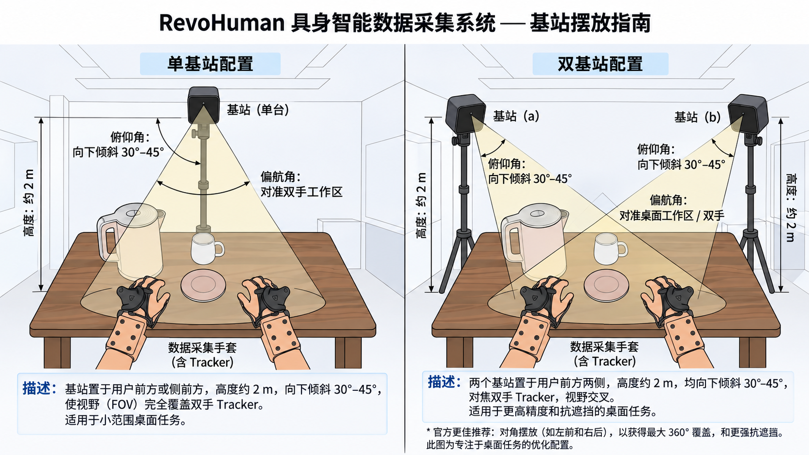
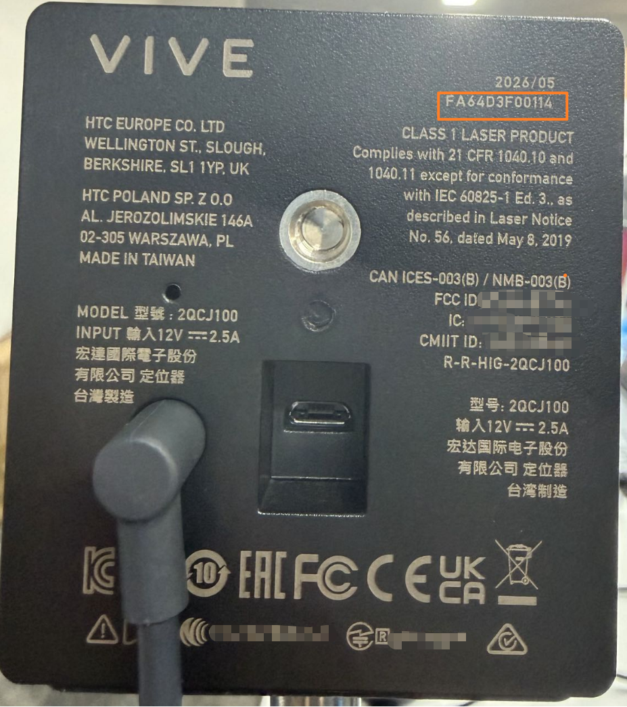

# 03 基站使用与配对

Tracker 的位置和姿态是靠基站扫出的红外光算出来的。SDK 要先知道「用的是哪几台基站」、
再知道「这几台基站摆在哪里」，才能给出可信的位姿。本章把这两件事做完：

1. **配对**：把在用的基站登记进白名单，并确认它们的信道互不冲突；
2. **标定**：人戴着手套在基站前走一圈，让 SDK 解出基站的位置（下文称「基站几何」）。
   标定同时确定了 Tracker 位姿所在的坐标系，定义见第 5.3 节。

什么时候需要做：

| 情况 | 要做的事 |
|---|---|
| 第一次使用 | 本章全部（第 2–6 节） |
| 换了场地、挪过或碰歪过基站、增减了基站 | 第 4 节（白名单有变化时）+ 第 5 节重新标定 |
| 程序提示基站几何失效、被挪动过，或要求重新标定 | 第 5 节重新标定（先看第 7 节） |
| 日常开机使用 | 只做第 6 节的启动前自查 |

## 1. 开始之前

- 已按《01-环境安装与系统要求》执行完全部步骤（本章用到其中的蓝牙软件包 `bluez` 与 SDK 的基站蓝牙组件）。
  在 Docker 容器里使用时，本章各步在主机与容器里分别怎么执行，见《08-容器运行》第 7 节。
- 两只手套已按《02-硬件连接》接好，`python3 -m revohuman doctor` 显示 `fail=0`。
  标定时 SDK 按手套单元自动找到每只手的 Tracker，手套没接上就找不到 Tracker。
- 两只 Tracker 都已开机，指示灯为绿色。怎么开机、各种灯色是什么意思见第 1.2 节。
- 基站已通电并**固定牢靠**：装在支架或墙上、高于头顶、朝下对着工作区，不要放在会被人碰到的桌面上。
  标定之后基站一旦被挪动或碰歪，就必须重新标定。怎么摆见第 1.1 节。
- 工作区的光照与周围环境已按第 1.1 节「摆放环境」检查过：没有阳光直射和强光，基站视野里没有镜子、玻璃等反光面。
- 关掉所有正在使用 Tracker 的程序：`revohuman-live`、可视化的实时模式、录制脚本、ROS 2 节点。
  一套 Tracker 同一时刻只能被一个程序打开，第 5、6 节的命令要独占它。

### 1.1 基站摆放建议



- **高度与朝向**：基站装在约 2 m 高处（高于头顶），向下倾斜 30°–45°，水平方向对准双手的工作区。
- **一台基站**：放在人的前方或侧前方，视野要完整覆盖两只手的 Tracker。适合在桌面上小范围操作。
- **两台基站**：分别放在人前方的左右两侧，视野在工作区交叉，精度更高、也不容易被遮挡。
  人需要转身、要求四周都照得到时，改为对角摆放（例如左前和右后）。
- 摆好后固定牢，再按第 4 节登记白名单。白名单里可以用 `place` 记下每台的位置（第 4.3 节），报错时便于认出是哪一台。

**摆放环境**

Tracker 靠接收基站扫出的红外光来定位，环境里的强光、反光和遮挡会直接干扰定位。
标定一直停在「几何置信度偏低」、或者 Tracker 静止不动位姿却在漂移，最常见的原因就是环境。
以下各条参考 VIVE 官方对 SteamVR 基站与 Vive Tracker 的使用说明：

- **避开强光**：基站和工作区都不要被阳光直射，也不要让强光灯直照基站或 Tracker。
  窗户多、阳光强的房间，标定和采集时拉上窗帘。
- **去掉反光面**：基站视野里、工作区周围不要有镜子、玻璃（窗户、玻璃门、玻璃桌面）、亮面油漆、抛光的金属件、
  亮面桌面和显示屏这类反光表面，搬不走的用布或哑光材料遮住。反光会让 Tracker 收到从别处反射过来的光，解算出错误的位置。
  检查方法：站到基站的位置朝工作区看，视线里能看到的亮面都要处理。
- **视线无遮挡**：基站与 Tracker 之间不要有物体挡着；采集时每只 Tracker 都至少要被一台基站照到。
  基站正前方不要放其他设备、隔板等遮挡物。
- **装稳、不振动**：用三脚架、灯架，或固定在墙上、稳固的台面上；不要装在会晃动、会振动的支架或台面上，
  也不要装在人来回走动容易碰到的地方。基站开机之后不要再挪动或调整角度。
- **正面对准工作区**：基站正面朝向双手工作区的中心。SteamVR 基站 2.0 的视野约为水平 150°、垂直 110°，
  双手的活动范围要落在视野内。
- **与 Tracker 保持距离**：Tracker 离基站至少 0.5 m。
- **远离红外设备**：基站发出的红外信号可能干扰附近的红外遥控器、红外传感器等设备，二者尽量隔开。

环境改过之后（遮住了反光面、换了窗帘、挪了基站等），按第 5 节重新标定。

官方原文：
[Tips for setting up SteamVR Base Station 2.0](https://www.vive.com/us/support/vive-pro2/category_howto/tips-for-setting-up-base-station2.html)、
[Installing the base stations](https://www.vive.com/us/support/vive-pro2/category_howto/installing-the-base-stations.html)、
[SteamVR Base Station 2.0](https://www.vive.com/us/support/camtrack/category_howto/base-station2.html)、
[What to do when seeing drifting objects](https://www.vive.com/us/support/vive-pro-eye/category_howto/what-to-do-when-seeing-drifting-objects.html)、
[Setting up your play area for tracking](https://business.vive.com/us/support/vive-lbss/category_howto/setting-up-your-play-area-for-tracking.html)。

### 1.2 打开 Tracker，看指示灯

Tracker 要开机后才能接收基站的光。配对与标定之前，对两只 Tracker 各做一遍：

1. 找到 Tracker 上的电源键（Tracker 上唯一的按键，不是手套上的按键）。
2. **短按一下**开机。不要按住：按住约 2 秒会进入无线配对模式，本套件用不到。
3. 看状态指示灯，**变成绿色**即已开机、工作正常，可以往下做。

| 指示灯 | 含义 | 怎么做 |
|---|---|---|
| 绿色 | 正常模式 | 继续第 2 节 |
| 蓝色（常亮或闪烁） | 常亮：正在连接；闪烁：进入了无线配对模式 | 常亮时等几秒看是否变绿；闪烁或一直不变绿时，按住电源键约 5 秒关机，再短按开机 |
| 红色闪烁 | 电量低 | 保持 USB 线连接充电，可以边充边用 |
| 不亮 | 已关机 | 短按电源键开机 |

本套件的 Tracker 经手套单元的 USB 线直接把数据传给主机，**不需要做 SteamVR 里的无线配对**；
本章说的「配对」是登记基站（第 4 节），与 Tracker 的无线配对无关。
按官方说明，Tracker 超过 5 分钟没有移动会自动关机（指示灯熄灭），再短按开机即可。
电源键与指示灯的完整说明见《02-硬件连接》第 2.1 节。

指示灯为绿色只说明 Tracker 开机正常。它是否看得到基站，以第 5 节标定和第 6 节 `tracker check --live` 的结果为准。

## 2. 蓝牙

基站的序列号与信道只能通过蓝牙读到，**配对、标定前的检查都离不开蓝牙**。
SDK 平时只从基站读取信息；只有第 4.2 节的闪灯和第 4.5 节的改信道会向基站写入。

检查蓝牙服务在运行、适配器已打开：

```bash
systemctl is-active bluetooth
bluetoothctl show | grep Powered
```

应看到 `active` 与 `Powered: yes`。不是时，依次执行下面三条，再检查一次：

```bash
sudo systemctl enable --now bluetooth
sudo rfkill unblock bluetooth
bluetoothctl power on
```

`bluetoothctl show` 报 `No default controller available` 说明本机没有可用的蓝牙适配器，需要插一个 USB 蓝牙适配器。

## 3. 配置文件在哪里

基站白名单与标定门限写在一个配置文件里，默认位置是：

```text
~/.config/revohuman/lighthouses.yaml
```

需要放在别处时，用环境变量 `REVOHUMAN_LIGHTHOUSES` 指定路径，或在每条命令后加 `--whitelist <路径>`
（命令行优先于环境变量，环境变量优先于默认位置）。

本章每条命令开头都会打印一行 `配置：<路径>（…）`，说明这次读的是哪个文件。
用 pip 安装的 SDK 还会多打印一行 `配置：! 不是从源码树运行（pip 安装属正常），不读仓库配置 → 用 …`，这是正常现象，不用处理。

## 4. 配对基站

### 4.1 扫描附近的基站

```bash
revohuman-lighthouses scan
```

扫描约 10 秒，期间会逐台连接基站读序列号。结束后列出附近所有基站：

```text
扫到 1 台基站（10s）；✓ = 在白名单
  序列号             广播名             信道     信号  白名单
  FAXXXXXXXXXX      LHB-XXXXXXXX     4    -58  ✓
✓ 白名单 1 台都扫到，信道无冲突；信道预检已刷新（5 分钟内有效）
```

| 列 | 含义 |
|---|---|
| 序列号 | 基站背面标签上 `FA` 开头的 12 位编号（见下图），**白名单只认这个** |
| 广播名 | 蓝牙里显示的 `LHB-` 开头的名字，仅供辨认 |
| 信道 | 基站的工作信道。同一场地里每台基站的信道必须不同 |
| 信号 | 蓝牙信号强度（dBm），越接近 0 越近 |
| 白名单 | `✓` 表示已登记 |



序列号印在基站背面的标签上（上图橙框处）。第 4.2 节认基站、第 4.3 节写白名单，用的都是这个编号；
`scan` 列表里的序列号应与标签上的一致。

第一次扫描时还没有白名单，最后一行会提示白名单不存在或没登记，属于正常情况，接着做 4.2。
某台基站序列号一栏为空时，离它近一点再扫一次。

### 4.2 分辨哪台是哪台（基站多时）

场地里基站多、分不清列表里的序列号对应哪一台时，可以让某一台闪灯到现场认：

```bash
revohuman-lighthouses identify FAXXXXXXXXXX --seconds 10
```

把 `FAXXXXXXXXXX` 换成列表里的序列号（也可以写广播名 `LHB-XXXXXXXX`）。
要闪的基站不在白名单里时加 `--foreign`。

### 4.3 写白名单

先生成配置文件模板（文件已存在时不会覆盖，会提示 `已存在，没有覆盖`，直接编辑它即可）：

```bash
revohuman-lighthouses init
```

打开它，把要用的基站**序列号**填进 `lighthouses` 一节，每台一行：

```bash
${EDITOR:-nano} ~/.config/revohuman/lighthouses.yaml
```

填好后的样子（两台基站；`place` 可以不写，写上便于日后辨认）：

```yaml
lighthouses:
  - serial: FAXXXXXXXXXX
    place: 左前上方
  - serial: FAYYYYYYYYYY
    place: 右后上方
calibration:
  coverage_cells: 2         # 视角覆盖格数（每台基站最多 10 格；2 及以下采到位姿即满足；0 关闭整个视角覆盖检查）
  coverage_span_deg: 5      # 从基站看过去，手左右跨过的张角（度）
```

- 只填**在用**的基站。场地里其他人的基站不要填，SDK 会把它们当作外来基站排除在外。
- 不要填广播名或信道，SDK 会自己从蓝牙读。
- `calibration` 一节保持默认即可，它决定第 5 节标定时要走多少个位置。
- 写着真实序列号的文件不要提交进公开的代码仓库。

检查白名单能否被正确读出（不用蓝牙，立即返回）：

```bash
revohuman-lighthouses show
```

没有 `✗` 即为正确。写错时会指出第几行、错在哪里，例如
`第 11 行：'FAXXXXXXXXXX' 是模板里的占位符：请换成基站背面标签上 FA 开头的 12 位序列号`。

### 4.4 再扫一次，确认信道

```bash
revohuman-lighthouses scan
```

最后一行是 `✓ 白名单 N 台都扫到，信道无冲突；信道预检已刷新（5 分钟内有效）` 时，直接进入第 5 节。
其他情况：

| 提示 | 处理 |
|---|---|
| `✗ 白名单里的 … 本次没扫到` | 基站没通电、离得太远，或序列号还没读出过。靠近些、确认通电后重扫 |
| `✗ … 与 … 同在 chN` | 两台在册基站信道相同，Tracker 分不开它们。按 4.5 改信道 |
| `! … 的信道从 chA 变成了 chB` | 基站的信道被改过。确认无冲突后，必须重新标定（第 5 节） |
| `蓝牙是必需的：…` | 蓝牙不可用，回到第 2 节 |

### 4.5 改信道（仅在有冲突时）

先看自动方案，这一步只打印、不写入：

```bash
revohuman-lighthouses plan
```

没有冲突时最后一行是 `白名单里的站都不用挪`，下面的 `apply` 不用执行。
有冲突时，方案只会挪白名单里的基站。确认无误后执行（会向基站写入新信道，并自动重扫复验）：

```bash
revohuman-lighthouses apply --yes
```

看到 `✓ 重扫复验通过` 和 `下一步：revohuman-lighthouses scan（刷新信道预检）→ …` 即完成。
**改过信道之后必须做第 5 节的标定**，旧的标定结果不再有效。

## 5. 标定基站几何

### 5.1 执行标定

标定要求 5 分钟内做过一次成功的扫描（第 4.4 节的最后一行）。开始前确认两只 Tracker 的指示灯都是绿色（第 1.2 节），
然后先扫描，紧接着开始标定：

```bash
revohuman-lighthouses scan
```

```bash
python3 -m revohuman tracker calibrate
```

### 5.2 怎么走

戴好两只手套（Tracker 在手背上），站到基站照得到的工作区里，面向基站：

1. 先把**双手左右分开**，和肩同宽或更宽，手背朝向基站，停住约 1 秒；
2. **换一个位置**再停住约 1 秒：前后挪一步、双手抬高或放低；
3. 照屏幕提示重复第 2 步，每换一处都停一下，不要一直晃动。

全程注意：

- 不要用身体、手臂挡住另一只手的 Tracker，也不要背对基站；
- 开始前按第 1.1 节「摆放环境」检查过：没有阳光直射和强光，基站视野里没有镜子、玻璃、亮面金属等反光面，反光会让解算出错；
- 多台基站时，尽量站在几台基站都能照到的区域中间。

标定过程中每秒打印一行进度，`→` 后面是下一步该做什么：

| 提示 | 怎么做 |
|---|---|
| `请在基站视野内缓慢移动双手，每处停住约 1 秒` | 还没看到有效数据：确认站在基站前、手背朝向基站 |
| `请把手左右挪开（从基站看过去横向移动，一只手来回挪也行），每处停住约 1 秒` | 从基站看过去，手的左右跨度还不够：左右拉开些。上下挪动不算 |
| `请把双手换到另一个位置（前后、高低各挪一次），每处停住约 1 秒` | 换一处站位或高度 |
| `判据已满足，连续成立 3 秒即完成（已 …s）` | 已经够了，保持 Tracker 在基站视野内，几秒后自动完成 |
| `视角覆盖已达标`，同一行前面是 `未达标：LHB-XXXXXXXX(几何置信度偏低)` | 走动已经够了，但这台基站解出的结果一致性太差、通不过验收，多半是环境干扰（反光、强光）。停在这一行超过约 30 秒时，继续走动一般不会好转：按 `Ctrl-C` 中止（会回滚），按第 1.1 节「摆放环境」排查后重跑 5.1 |

只有一台基站时，实测从第一行进度到完成约 10–20 秒。最后一行是：

```text
标定完成：在册基站均已解出：LHB-XXXXXXXX
```

退出码为 `0`。其他结果：

| 结果 | 含义与处理 |
|---|---|
| `标定失败：…`，下一行 `（config 已回滚到标定前）` | 这次没解出来或解出的结果验收不通过，基站几何已恢复到标定前的状态。按失败原因调整（例如换个位置，或按第 1.1 节「摆放环境」处理反光和强光）后重跑 5.1 |
| `标定被拒（…）：` | 标定前的条件不满足，没有开始标定。例如离上次扫描超过了 5 分钟，重跑 5.1 即可；其他原因按提示处理 |
| 超过 5 分钟没完成 | 按失败处理，同样会回滚 |
| `Ctrl-C` 中止 | 同样会回滚，可以放心重来 |

### 5.3 标定得到的坐标系

标定在解出基站位置的同时，确定了一个固定在场地里的三维直角坐标系，下文称「基站坐标系」。
Tracker 的绝对位姿都在这个坐标系里表达：SDK 的 `latest()`、录制文件里的 Tracker 数据、ROS 2 的 `tracker_pose` 话题。

| 项目 | 定义 |
|---|---|
| 类型 | 右手直角坐标系 |
| 单位 | 位置为米。姿态为单位四元数：SDK 与录制文件中按 (w, x, y, z) 排列，ROS 2 消息中按 ROS 惯例为 (x, y, z, w) |
| +Z 轴 | 竖直向上。解算时由基站与 Tracker 内置的加速度计约束，接近但不严格等于铅垂方向 |
| +Y 轴 | 水平方向，从原点指向**参考基站**：参考基站总在 +Y 轴正上方（它的 x 约为 0，y 为正） |
| +X 轴 | 由右手定则确定（X = Y × Z）：站在原点、面朝参考基站时，+X 指向右手边 |
| 水平原点 | 标定过程中 Tracker 停住过的某一处位置，由解算自动选取。不是基站的位置，也不是地面上的某个标记 |
| 高度零点 | 约为标定过程中 Tracker 停住过的最低高度。z 是相对这一高度的高低，**不是离地高度** |
| 位姿描述的对象 | Tracker 自身的坐标系（由 Tracker 出厂标定数据定义）。SDK 不叠加 Tracker 在手套上的安装偏移；需要手背或手腕的位姿时，请自行测量安装关系后换算 |

**参考基站**：只有一台基站时就是它。有多台时，标定输出里会打印
`Using LH … (xxxxxxxx) as reference lighthouse`，以最后出现的那一行为准，括号里是参考基站的 8 位编号
（与 `tracker status` 里序列号后面括号中的编号相同）。

**坐标系随标定而定**：

- 每次标定都重新建立基站坐标系。水平原点、+Y 的朝向、高度零点取决于这次标定时人站在哪里、手放在哪里，
  **基站没动、只是重新标定，坐标系也会变**（实测差过近 20 cm、约 5°）。不同次标定下的绝对位姿不能直接比较。
- 标定之后，运行时 SDK 不再重新解算基站位置，坐标系保持不变；同一次标定下的绝对位姿可以直接比较。
- 基站被挪动后，坐标系随之失效。SDK 检测到时会停止采集（第 7 节），检测不到的情况见第 8 节；挪动过基站必须重新标定。

**相对零位的增量**：SDK 的 `delta()` 与 ROS 2 的 `tracker_delta` 话题给出相对零位的增量，
位置 = R₀ᵀ(p − p₀)，姿态 = R₀ᵀR，其中 p₀、R₀ 是记零位那一刻 Tracker 的位置与姿态。
增量表达在**零位那一刻 Tracker 自身的坐标系**里，与基站坐标系的原点、朝向无关。
零位默认在每次启动采集时自动记一次，见《04-数据录制》第 1 节。

## 6. 启动前自查

标定完成后，以及日常每次开始录制之前，用下面的命令确认基站可用。
开始前先看一眼两只 Tracker 的指示灯：不是绿色时先按第 1.2 节处理。

只检查文件，不打开设备，立即返回：

```bash
python3 -m revohuman tracker check
```

再打开一次 Tracker，把基站与位姿实际验一遍（要十几秒，最长约半分钟）：

```bash
python3 -m revohuman tracker check --live
```

通过时看到 `✓ S0 静态门 通过` 与 `✓ S1 起流后门（…）通过`，退出码 `0`，随后几行列出每台在册基站及其信道。
`[tracker-gate] …` 那一行是供技术支持排查用的摘要，可以不看。
加 `--live` 时，前面还会先打印若干 Tracker 驱动的 `Info:` / `Warning:` 行
（例如只有一台基站时的 `Warning: Disabling LH 1`），属于正常输出，以最后的 `✓` / `✗` 行为准。

不通过时显示 `✗ … 被拦（原因）：`，下面是原因说明和 `修复：` 一节可以直接执行的命令，退出码 `1`。

随时查看当前状态（离线，不打开任何设备）：

```bash
python3 -m revohuman tracker status
```

```text
在册基站：FAXXXXXXXXXX（xxxxxxxx）
信道预检：有效
基站几何：可用（已解出 1 台）
零位：无
上次启动门：S1 通过  MM-DD hh:mm:ss  mode=error
```

最后一行是最近一次启动检查的结果与时间。

`基站几何` 一行显示「不可用」时退出码为 `1`，按第 5 节重新标定。
`信道预检` 显示过期是正常的，它只在标定前需要（第 5.1 节会先扫描）。
`零位` 是录制等程序启动时记下的双手 Tracker 位姿（记在第 5.3 节的坐标系里），默认每次启动重新记；括号里说明这份记录能否沿用，重新标定过基站或超过有效期后不能沿用。见《04-数据录制》第 1 节。

## 7. 运行时保护

录制或广播期间，SDK 每秒核对一次基站几何。出问题时会作废当前这段数据或停止采集，
并在终端打印带错误码的一行。含义与处理：

| 看到的提示 | 含义 | 处理 |
|---|---|---|
| `[1906] 运行期基站几何丢失（wipe）…` 或 `（changed）…` | 某台基站的位置与标定记录对不上了：被挪动、碰歪，或驱动清掉了它的位置（见第 8 节第 3 条）。之后的位姿不再可信，**已停止采集** | 退出程序，执行 `revohuman-lighthouses scan`，再执行 `python3 -m revohuman tracker calibrate` 重新标定，然后重新启动。**只重启不重标没有用**，启动检查会再次拦下 |
| `[1906] 运行期基站几何丢失（unavailable）…`，结尾是 `当段已作废；去掉遮挡后几何门会自己放行` | 基站被遮挡、能用的基站不够，持续约 3 秒 | 当前这段数据作废；去掉遮挡后自动恢复，不用重启 |
| `[1906] 运行期基站几何丢失（drift）…` | 多台基站时，基站之间的距离与标定记录不符 | 同上，条件消失后自动恢复；反复出现说明有基站松动，固定后重新标定 |
| 错误码 `1902`，提示 `世界系已变更` | 在册基站的位置在采集中发生了变化，此后的位姿与之前不在同一个坐标系里 | 固定好基站，按第 5 节重新标定后重新启动 |
| `运行中整体停流——tracker 全部掉线或 USB 被拔` | 所有 Tracker 超过 10 秒没有数据 | 检查手套与 Tracker 的连接，重新启动程序 |
| 位姿跳变告警（相邻两帧位移超过 5 cm 或转角超过 17.2°） | 多发生在遮挡刚结束时 | 只告警、不停止。频繁出现时按第 1.1 节「摆放环境」检查遮挡、反光与强光 |
| 启动时 `[1905] tracker 未就绪（…）：…` | 启动检查没通过 | 报错里列出了原因和修复命令，照做即可 |

录制时作废的段怎么识别，见《04-数据录制》第 5 节。

`revohuman-live` 默认以 `flag` 档运行（见《04-数据录制》第 7 节）：基站检查不通过时照常广播，
只在状态里标出问题，便于边看画面边排查。遇到上表第一行那类不可恢复的情况时，它的状态会显示
`tracker 已停：…（位姿不再更新，需重开广播）`，可视化左下角会显示 `tracker stopped: … (restart the SDK broadcast)`，
处理方法与上表相同。

## 8. 已知限制

1. **重新见光时有一步跳变**：遮挡结束、重新看到基站的那一刻，原始位姿会跳一下
   （实测约 2–3.5 cm，姿态最大约 30°）。SDK 的实时接口默认把这一跳平滑成约 0.3–1.6 秒的滑移；
   录制文件与 ROS 2 话题里是原始位姿，保留这一跳。第 7 节的跳变告警只统计超过 5 cm / 17.2° 的跳变。
2. **有些挪动检测不到**：运行时 SDK 不重新解算基站位置，靠基站自己广播的重力方向判断它有没有被动过。
   所以基站被平移、或绕竖直轴转动（重力方向不变）时，SDK 检测不到，单台、多台基站都是如此；
   倾斜达到 2° 会被发现并停止采集，不到 2° 的倾斜检测不到。**动过基站之后务必重新标定**。
3. **重力读数抖动也会停止采集**：驱动按基站广播的重力方向判断基站有没有被挪动，变化达到 2° 就清掉这台基站的位置，
   程序随即停下，提示基站几何失效或被挪动过。没人碰过基站、但读数偶尔抖动超过 2° 时也会这样。
   此时重启没有用，执行 `revohuman-lighthouses scan`，再执行 `python3 -m revohuman tracker calibrate` 重新标定即可。

## 9. 常见问题

| 现象 | 原因与处理 |
|---|---|
| `scan` 一台基站都没扫到 | 蓝牙没开（第 2 节），或基站没通电 |
| `scan` 扫到的基站序列号为空 | 蓝牙连接没读出序列号。靠近基站再扫；仍不行时先用广播名 `LHB-…` 配合 `identify` 认出是哪一台，再看它背面标签 |
| 换了场地后，`plan` 提示的冲突里有旧场地的基站 | SDK 记得上次启动时光学上见过的基站。确认已换场地时加 `--ignore-optical`：`revohuman-lighthouses plan --ignore-optical` |
| `calibrate` 提示某只手找不到 Tracker | 该手套没接好或没通电，回到《02-硬件连接》；`python3 -m revohuman doctor` 应列出两个手套单元。也确认这只 Tracker 已开机、指示灯为绿色（第 1.2 节） |
| `calibrate` 长时间停在同一个提示 | 按提示换位置；一直没有进展时检查 Tracker 是否被挡、是否正对基站、附近是否有强反光 |
| `calibrate` 一直停在 `未达标：LHB-…(几何置信度偏低)  → 视角覆盖已达标` | 基站测到的数据一致性差，多半是反光或强光干扰。按 `Ctrl-C` 中止（会回滚），按第 1.1 节「摆放环境」处理好之后重跑 5.1，不用一直等 |
| Tracker 静止不动，位姿却在漂移或抖动 | 多半是反光或强光干扰，按第 1.1 节「摆放环境」检查；环境改过之后按第 5 节重新标定 |
| `check --live` 提示 `… 内没收到 … ：没通电、被挡住，或 tracker 看不见它` | 该基站没通电，或 Tracker 看不到它。确认基站通电、Tracker 在它视野内后重跑 |
| 标定或自查提示 Tracker `被挡住、背对基站或没开机`（或 `被遮挡、朝向不对或没开机`） | 先看这只 Tracker 的指示灯：不亮时短按电源键开机；是绿色时检查它是否被挡住、是否朝向基站（第 1.2 节） |
| Tracker 指示灯蓝色闪烁 | 按住电源键时间过长，进入了无线配对模式。本套件不需要：按住电源键约 5 秒关机，再短按开机 |
| Tracker 指示灯用着用着熄灭了 | Tracker 自动关机了（电量耗尽，或超过 5 分钟没有移动）：短按电源键开机；电量低时保持 USB 线连接充电 |
| 录制或广播中途停止，提示需要重新标定 | 见第 7 节表格第一行 |

全部错误码见《07-日志与错误码》。
